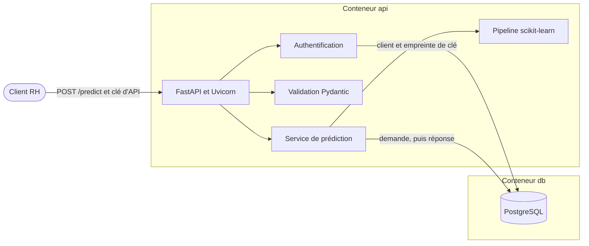
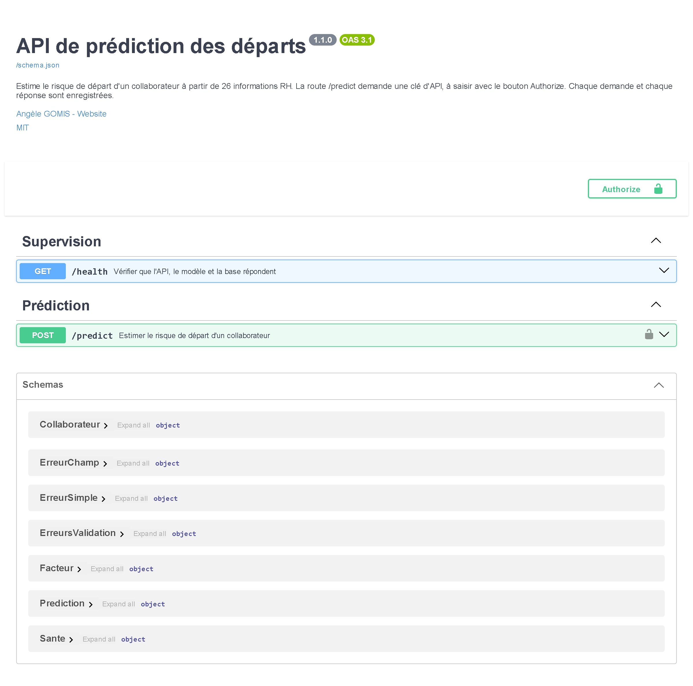
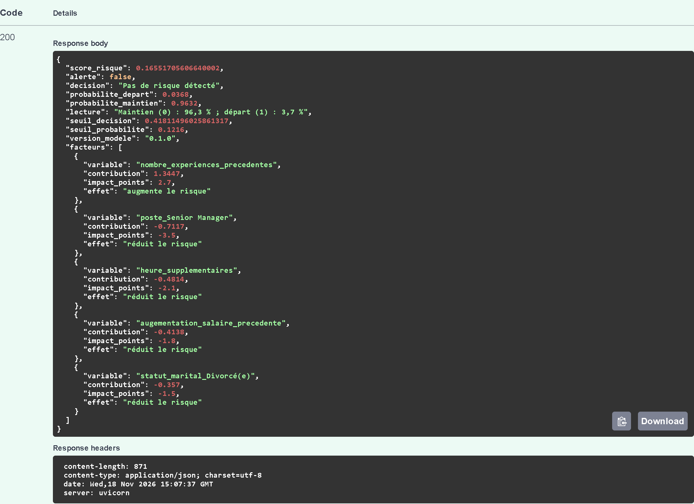

# P5 : déployer le modèle de départ des collaborateurs

[](https://github.com/MendyData/P5_Deploiement_ML/actions/workflows/ci.yml)


Preuve de concept pour l'entreprise Futurisys : le modèle de prédiction des départs
construit au projet 4 devient un service, avec une API, une base de données, des tests
et un déploiement automatisés.

## Sommaire

1. [À propos du projet](#à-propos-du-projet)
2. [Architecture](#architecture)
3. [Aperçu](#aperçu)
4. [Technologies](#technologies)
5. [Prérequis](#prérequis)
6. [Installation](#installation)
7. [Tests et qualité du code](#tests-et-qualité-du-code)
8. [Utilisation de l'API](#utilisation-de-lapi)
9. [Authentification](#authentification)
10. [Base de données](#base-de-données)
11. [Stockage et gestion des données](#stockage-et-gestion-des-données)
12. [Besoins analytiques](#besoins-analytiques)
13. [Modèle](#modèle)
14. [Environnements](#environnements)
15. [Intégration et déploiement continus](#intégration-et-déploiement-continus)
16. [Déploiement local](#déploiement-local)
17. [Choix techniques](#choix-techniques)
18. [Structure du projet](#structure-du-projet)
19. [Organisation du dépôt](#organisation-du-dépôt)
20. [Licence](#licence)

## À propos du projet

Le modèle estime, pour un collaborateur, un score de risque de départ entre 0 et 1,
puis déclenche une alerte quand ce score atteint le seuil de décision (0,418). Le
score est ensuite converti en probabilité de départ, ramenée à la vraie proportion
de départs (16 %), pour être lue directement par les RH.
Il a été conçu au projet 4 à partir de trois extraits RH (1 470 collaborateurs).

Dans ce dépôt, je le mets en production :

- un pipeline scikit-learn unique, des 26 informations brutes d'un collaborateur
  jusqu'au score ;
- une API FastAPI qui valide les données reçues et renvoie le score, l'alerte et
  la probabilité de départ ;
- une base PostgreSQL qui conserve chaque demande et chaque réponse ;
- des tests automatisés et un pipeline CI/CD avec GitHub Actions ;
- un déploiement local avec Docker Compose.

## Architecture



Parcours d'une prédiction :

1. Le client envoie les 26 informations d'un collaborateur à `POST /predict`.
2. Uvicorn reçoit la requête et la transmet à FastAPI.
3. L'authentification retrouve le client par l'empreinte de sa clé : sinon 401.
4. Pydantic valide les données : sinon 422, avec le champ en cause.
5. La demande est enregistrée dans PostgreSQL.
6. Le modèle, chargé une seule fois au démarrage, calcule le score, puis la
   probabilité de départ.
7. La réponse est enregistrée, reliée à la demande, puis renvoyée en JSON.

Si la base ne répond pas, l'API renvoie 503 : aucune prédiction n'est servie sans
trace. Git, GitHub Actions, Pytest et Docker entourent ce parcours : ils le
rendent versionné, vérifié, testé et reproductible.

## Aperçu





## Technologies

| Outil | Version | Rôle |
| --- | --- | --- |
| Python | 3.11 | Langage, à la version d'entraînement du modèle |
| scikit-learn | 1.9.1 | Pipeline et régression logistique |
| pandas | 3.0.6 | Manipulation des données |
| numpy | 2.4.6 | Calcul numérique |
| joblib | 1.6.0 | Sauvegarde et chargement du modèle |
| FastAPI | 0.163 | API et documentation Swagger |
| Uvicorn | 0.54 | Serveur qui exécute l'API |
| Pydantic | 2.14 | Validation des données reçues |
| pydantic-settings | 2.16 | Paramètres lus dans l'environnement et validés |
| PostgreSQL | 16 | Base de données, lancée dans Docker |
| SQLAlchemy et psycopg | 2.1 et 3.3 | Accès à la base depuis Python |
| uv | 0.12 ou plus | Environnement et dépendances |
| Pytest et pytest-cov | 9.2 et 7.1 | Tests et couverture |
| Ruff | 0.17 | Vérification et format du code |
| GitHub Actions | | Intégration et déploiement continus |
| Docker et Docker Compose | Docker Desktop | Image de l'application et lancement local |

Les versions exactes de toutes les dépendances, y compris indirectes, sont figées
dans `uv.lock`. Ce fichier et `pyproject.toml` remplacent un `requirements.txt`.

## Prérequis

- Git
- [uv](https://docs.astral.sh/uv/) : il installe lui-même Python 3.11 si besoin
- [Docker Desktop](https://docs.docker.com/desktop/), pour le déploiement local

## Installation

```bash
git clone https://github.com/MendyData/P5_Deploiement_ML.git
cd P5_Deploiement_ML
uv sync --locked
cp .env.example .env
```

- `uv sync --locked` crée l'environnement `.venv` et installe exactement les versions
  de `uv.lock`. La commande échoue si le verrou n'est plus à jour.
- `.env` contient les réglages de mon poste. Il est ignoré par Git : aucun secret
  n'est versionné. `.env.example` liste les variables attendues.
- Dans `.env`, je renseigne les deux mots de passe de la base. `.env.example`
  donne la commande qui les génère.

## Tests et qualité du code

```bash
docker compose up -d db
uv run pytest -m "not lent" --cov=src
uv run ruff check .
uv run ruff format --check .
```

| Tests | Ce qui est vérifié |
| --- | --- |
| `tests/unitaires/` | Configuration, paramètres, features métier, pipeline, entraînement, schémas, explication du score |
| `tests/fonctionnels/test_non_regression.py` | Le pipeline redonne les scores et les métriques du projet 4 sur les 294 collaborateurs du jeu de test |
| `tests/fonctionnels/test_predicteur.py` | Artefact vérifié avant chargement, prédiction |
| `tests/fonctionnels/test_api.py` | Routes de l'API : 200, 401, 422, 500, 503, traces enregistrées, Swagger |
| `tests/fonctionnels/test_bdd.py` | Création de la base, insertion du jeu de données, clients de l'API |
| `tests/fonctionnels/test_integrite_bdd.py` | Types, valeurs absentes, contraintes, cohérence métier, clés, insertion, suppression, droits du rôle de l'API |
| `tests/fonctionnels/test_parcours_complet.py` | Un client envoie les exemples fournis, ses traces sont relues, puis il est désactivé |

- 191 tests : 183 rapides et 8 marqués `lent`.
- Couverture : 100 % du code de `src`, branches comprises. Le seuil imposé est de
  80 % (`fail_under` dans `pyproject.toml`) : en dessous, la commande échoue, et la
  CI avec elle. Le rapport est dans
  [docs/rapport_couverture.md](docs/rapport_couverture.md).
- Les tests de l'API et de la base ont besoin de PostgreSQL. Ils créent leur propre
  base, `p5_test`, recréée vide à chaque exécution : la base de développement n'est
  jamais touchée. Si PostgreSQL manque, ces tests échouent : ils ne sont pas ignorés.
- Les tests marqués `lent` réentraînent le modèle ou lisent les données RH complètes.
  Ces données ne sont pas dans le dépôt : sans elles, ces tests sont ignorés.
- Les données de test sont versionnées dans `tests/fixtures/` et les graines
  aléatoires sont fixées : deux exécutions donnent le même résultat.

## Utilisation de l'API

```bash
docker compose up -d db
uv run python scripts/creer_base.py
uv run uvicorn src.api.application:app --reload
```

La base doit être démarrée et initialisée : l'API enregistre chaque demande avant
de calculer. La documentation interactive (Swagger) est sur <http://localhost:8000/docs> : chaque
route y est décrite, avec ses schémas et un exemple prêt à envoyer.

Le [guide d'utilisation](docs/guide_utilisateur.md) s'adresse aux utilisateurs de
l'API : envoi d'une demande pas à pas, les 26 informations et leurs valeurs, lecture
de la réponse et de la fiche RH, erreurs, appels en PowerShell, curl et Python.

| Route | Rôle | Clé d'API |
| --- | --- | --- |
| `GET /health` | Indique que l'API, le modèle et la base répondent | Non |
| `POST /predict` | Reçoit les 26 informations d'un collaborateur, renvoie sa prédiction | Oui |

Réponse de `POST /predict` :

```json
{
  "score_risque": 0.16551705606640005,
  "alerte": false,
  "decision": "Pas de risque détecté",
  "probabilite_depart": 0.0368,
  "probabilite_maintien": 0.9632,
  "lecture": "Maintien (0) : 96,3 % ; départ (1) : 3,7 %",
  "seuil_decision": 0.41811496025861317,
  "seuil_probabilite": 0.1216,
  "version_modele": "0.1.0",
  "facteurs": [
    {
      "variable": "nombre_experiences_precedentes",
      "contribution": 1.3447,
      "impact_points": 2.7,
      "effet": "augmente le risque"
    }
  ]
}
```

- `score_risque` : score brut du modèle, entre 0 et 1. Il classe les collaborateurs
  et déclenche l'alerte, mais ne se lit pas comme un pourcentage : le modèle a été
  entraîné sur des classes rééquilibrées (`class_weight="balanced"`), ce qui gonfle
  ses scores.
- `alerte` et `decision` : vrai, ou « Risque de départ », quand le score atteint
  `seuil_decision`.
- `probabilite_depart` : le score corrigé du rééquilibrage, ramené au taux de départ
  de l'entraînement (16,2 %). C'est le chiffre à communiquer : ici, 3,7 % de risque
  de départ. `probabilite_maintien` en est le complément.
- `lecture` : les deux probabilités en pourcentages, maintien (classe 0) et départ
  (classe 1), prêtes à lire pour les RH.
- `seuil_probabilite` : le seuil de décision exprimé en probabilité, environ 12 %.
  La correction conserve l'ordre des scores : l'alerte est la même, que l'on compare
  le score à 0,418 ou la probabilité à 12 %.
- `facteurs` : la fiche RH, c'est-à-dire les cinq variables qui pèsent le plus dans
  ce score. Une contribution positive pousse vers le départ, une contribution
  négative vers le maintien. Elle s'exprime en log-cote, l'échelle interne du
  modèle. `impact_points` la traduit en points de probabilité de départ : ici,
  les expériences précédentes ajoutent 2,7 points par rapport à un collaborateur
  moyen.

| Code | Signification |
| --- | --- |
| 200 | Prédiction calculée |
| 401 | Clé d'API absente ou invalide |
| 422 | Données refusées : chaque champ en cause est listé, avec la raison en français |
| 500 | La base répond mais refuse l'enregistrement : aucune prédiction n'est servie |
| 503 | Base de données injoignable : sans trace possible, aucune prédiction n'est servie |

Les données sont refusées (422) quand un champ manque, est inconnu, hors bornes ou
d'une modalité non prévue, ou quand le profil est incohérent. Chaque nombre a une
borne haute, un peu au-dessus du maximum observé au projet 4 : par exemple 50 000
pour le revenu mensuel, qui n'y dépasse pas 19 999. Les règles de cohérence
reprennent les contrôles de mon analyse du projet 4, qui ne relevaient aucune
violation sur les 1 470 collaborateurs :

- l'ancienneté dans le poste, la dernière promotion et l'ancienneté sous le
  responsable actuel ne dépassent pas l'ancienneté dans l'entreprise ;
- l'ancienneté dans l'entreprise ne dépasse pas l'expérience totale ;
- le revenu mensuel est positif ;
- l'entrée dans la vie active (âge moins expérience totale) se fait à 16 ans au
  plus tôt.

La base vérifie les mêmes règles avec des contraintes `CHECK` : elles restent
appliquées même si l'API change.

Deux exemples d'entrées sont fournis dans `docs/exemples/` :

```bash
curl -X POST http://localhost:8000/predict -H "X-API-Key: MA_CLE" -H "Content-Type: application/json" -d @docs/exemples/collaborateur_avec_alerte.json
```

Le modèle est vérifié puis chargé une seule fois, au démarrage. Les données sont
validées par le schéma `src/schemas/collaborateur.py`, dont les valeurs autorisées
viennent de `src/config.py`.

## Authentification

`POST /predict` demande une clé d'API, envoyée dans l'en-tête `X-API-Key`. Dans
Swagger, je la saisis avec le bouton « Authorize ».

```bash
uv run python scripts/creer_utilisateur.py equipe-rh
```

- Le script enregistre le client dans la table `utilisateurs` et affiche sa clé,
  une seule fois. Je la transmets au client.
- Seule l'empreinte SHA-256 de la clé est enregistrée : la clé n'est écrite ni dans
  le code, ni dans le dépôt, ni dans la base, ni dans les journaux.
- Une clé absente, inconnue ou rattachée à un client désactivé (`actif` à faux)
  reçoit la réponse 401.
- Chaque demande est rattachée au client qui l'a envoyée.

## Base de données

PostgreSQL 16, lancé par Docker Compose. Le schéma complet, avec son diagramme, est
dans [docs/schema_bdd.md](docs/schema_bdd.md).

| Table | Contenu |
| --- | --- |
| `collaborateurs` | Jeu de données complet du projet 4 (1 470 lignes) |
| `utilisateurs` | Clients de l'API et empreinte de leur clé |
| `demandes` | Données reçues par `POST /predict`, enregistrées avant tout calcul |
| `reponses` | Prédiction renvoyée, reliée à sa demande |

| Script | Rôle |
| --- | --- |
| `scripts/creer_base.py` | Crée les tables, leurs relations et le rôle de l'API ; peut être relancé |
| `scripts/inserer_dataset.py` | Insère le jeu de données complet et contrôle le nombre de lignes |
| `scripts/creer_utilisateur.py` | Enregistre un client de l'API et affiche sa clé |
| `scripts/interroger_base.py` | Affiche les volumes, les dernières demandes et le taux d'alerte |

```bash
docker compose up -d db
uv run python scripts/creer_base.py
uv run python scripts/inserer_dataset.py
uv run python scripts/creer_utilisateur.py equipe-rh
```

Le jeu de données n'est pas dans le dépôt : `scripts/inserer_dataset.py` lit le
fichier `data/interim/consolide.csv` de mon poste.

## Stockage et gestion des données

Parcours d'une demande :

1. L'API identifie le client à partir de l'empreinte de sa clé.
2. Les 26 informations sont validées ; une donnée invalide n'est pas enregistrée.
3. La demande est enregistrée dans `demandes`.
4. Le modèle calcule le score et la probabilité de départ.
5. La réponse est enregistrée dans `reponses`, reliée à la demande.
6. La réponse part vers le client.

Si la base ne répond pas, l'API renvoie 503 : aucune prédiction n'est servie sans
trace.

| Sujet | Règle |
| --- | --- |
| Droits | L'API se connecte avec un rôle qui lit et ajoute des traces, sans pouvoir modifier ni supprimer. Le rôle propriétaire ne sert qu'aux scripts. |
| Données personnelles | Les données RH sont personnelles : aucun nom n'est stocké, l'accès passe par une clé, et la base n'est joignable que depuis le poste (`127.0.0.1`). |
| Conservation | Les traces ne sont jamais modifiées. Une purge par période (`DELETE ... WHERE recue_le < date`) est réservée au rôle propriétaire. |
| Sauvegarde | `docker compose exec db pg_dump -U proprietaire p5 > sauvegarde.sql` ; les données vivent dans le volume `donnees_postgres`. |
| Secrets | Les mots de passe sont dans `.env` sur le poste et dans les secrets des environnements GitHub. |

## Besoins analytiques

Les traces répondent à trois besoins : suivre l'usage, suivre le modèle et
préparer sa mise à jour.

| Indicateur | Question | Source |
| --- | --- | --- |
| Nombre de demandes par jour et par client | L'API est-elle utilisée, et par qui ? | `demandes.recue_le`, `demandes.utilisateur_id` |
| Taux d'alerte par semaine et par version du modèle | Le modèle alerte-t-il plus ou moins qu'avant ? | `reponses.alerte`, `reponses.version_modele` |
| Probabilité moyenne de départ par trimestre, comparée aux départs réellement observés | La probabilité annoncée reste-t-elle juste ? | `reponses.probabilite_depart`, puis les départs constatés par les RH |
| Score moyen par département et par poste | Où le risque se concentre-t-il ? | `demandes` jointe à `reponses` |
| Écart entre les demandes et le jeu d'entraînement | Les données reçues ressemblent-elles encore à celles du projet 4 ? | `demandes` comparée à `collaborateurs` |
| Demandes sans réponse | Une prédiction a-t-elle échoué ? | `demandes` sans ligne dans `reponses` |

```sql
SELECT date_trunc('week', r.calculee_le) AS semaine,
       r.version_modele,
       count(*) AS predictions,
       round(avg(r.alerte::int)::numeric, 3) AS taux_alerte
FROM reponses AS r
GROUP BY semaine, r.version_modele
ORDER BY semaine;
```

`scripts/interroger_base.py` exécute les requêtes de base. Un tableau de bord
pourrait se brancher sur ces mêmes requêtes avec un rôle en lecture seule.

## Modèle

Régression logistique du projet 4, réglée pour manquer peu de départs : sur les 294
collaborateurs du jeu de test, 36 départs sur 47 sont signalés (rappel de 0,77),
au prix de fausses alertes assumées (précision de 0,36). Les données, les
variables, le seuil, les limites, la maintenance et le protocole de mise à jour
sont décrits dans [docs/modele.md](docs/modele.md).

## Environnements

La variable `APP_ENV` indique où l'application tourne. Elle est lue et validée au
démarrage par `src/parametres.py` : une valeur inconnue arrête le démarrage.

| Environnement | `APP_ENV` | Où | D'où viennent les réglages |
| --- | --- | --- | --- |
| Développement | `development` | Mon poste | Fichier `.env`, ignoré par Git |
| Test | `test` | CI et branche `staging` | Environnement GitHub `test` |
| Production | `production` | Version taguée `vX.Y.Z` | Environnement GitHub `production` |

Aucun réglage sensible n'est écrit dans le code ni dans les workflows : la
variable `APP_ENV` et les secrets `POSTGRES_PASSWORD` et `POSTGRES_API_PASSWORD` de
test et de production sont déclarés dans GitHub (Settings, Environments).

## Intégration et déploiement continus

Deux workflows GitHub Actions, dans `.github/workflows/` :

| Workflow | Déclencheur | Ce qu'il fait |
| --- | --- | --- |
| `ci.yml` | Chaque push, sur toutes les branches | `uv sync --locked`, contrôles Ruff, tests avec couverture sur une base PostgreSQL jetable |
| `deploiement.yml` | Push sur `staging`, tag `vX.Y.Z` | Image construite, base et API lancées par Docker Compose, puis test de fumée |

- Je ne fusionne une branche dans `main` que si la CI est verte.
- Le test de fumée interroge `/health` : l'API, le modèle et la base doivent
  répondre ensemble.

## Déploiement local

```bash
docker compose up --build
```

Une seule commande, trois services lancés dans l'ordre :

1. `db` : la base PostgreSQL, dont les données sont gardées dans un volume.
2. `initialisation` : crée les tables et le rôle de l'API, puis s'arrête.
3. `api` : sert l'API sur <http://localhost:8000>, avec le rôle aux droits limités.

- Docker construit l'image en suivant le `Dockerfile` : Python 3.11, dépendances
  figées de `uv.lock`, code, modèle, utilisateur sans droits d'administration.
- Les réglages et les mots de passe viennent du fichier `.env`.
- Premier lancement : j'insère ensuite le jeu de données et je crée un client
  (voir [Base de données](#base-de-données)).
- `docker compose down` arrête tout en gardant les données ; `docker compose down -v`
  supprime aussi le volume.

## Choix techniques

| Choix | Raison | Alternative écartée |
| --- | --- | --- |
| uv, `pyproject.toml` et `uv.lock` | Mêmes versions sur le poste, dans la CI et dans l'image | pip et `requirements.txt` tenu à la main |
| Un seul pipeline scikit-learn | La préparation et le modèle forment un artefact : mêmes scores qu'au projet 4 | Préparation recodée dans l'API |
| Probabilité corrigée du rééquilibrage | Un pourcentage lisible par les RH, sans toucher au modèle du projet 4 ni à son rappel | Réentraîner sans `class_weight="balanced"` : même calibration, rappel de 0,72 au lieu de 0,77 |
| FastAPI et Pydantic | Validation et documentation Swagger produites à partir du code | Flask et validation écrite à la main |
| Clé d'API, empreinte SHA-256 | Clé tirée au hasard, rien en clair, adapté à un appel entre applications | Mot de passe et jeton JWT |
| PostgreSQL, deux rôles | Contraintes fortes ; l'API ne peut ni modifier ni supprimer | SQLite, sans rôles |
| Demande enregistrée avant le calcul | Aucune prédiction sans trace ; 503 si la base ne répond pas | Journal dans un fichier |
| Trois branches et GitHub Actions | Chaque version passe par le test avant la production | Déploiement à la main |
| Docker Compose | Une commande, la même installation partout | Installation manuelle de PostgreSQL et de Python |

## Structure du projet

```text
P5_Deploiement_ML/
├── .github/workflows/     Workflows GitHub Actions : CI et déploiement
├── data/                  Données (non versionnées)
├── docs/                  Guide d'utilisation, modèle, schéma de la base, exemples, couverture, captures
├── models/                Modèle sauvegardé, métadonnées et découpage des données
├── notebooks/             Explorations
├── scripts/               Entraînement, base de données, clients de l'API
├── src/
│   ├── config.py          Colonnes, modalités et chemins du projet
│   ├── parametres.py      Paramètres par environnement et accès à la base
│   ├── api/               Application FastAPI, authentification, erreurs
│   ├── bdd/               Tables, connexion et initialisation de la base
│   ├── modele/            Pipeline, features métier, prédicteur, explication
│   ├── schemas/           Schémas Pydantic d'entrée et de sortie
│   └── services/          Service de prédiction
├── tests/
│   ├── fixtures/          Données de référence versionnées
│   ├── fonctionnels/      Non-régression, prédicteur, API, base, parcours complet
│   └── unitaires/         Configuration, paramètres, schémas, pipeline, explication
├── .dockerignore          Fichiers laissés hors de l'image
├── .env.example           Modèle des variables d'environnement
├── CHANGELOG.md           Journal des changements, version par version
├── Dockerfile             Recette de l'image de l'application
├── docker-compose.yml     Lancement local
├── pyproject.toml         Projet, dépendances et réglages des outils
└── uv.lock                Versions figées de toutes les dépendances
```

## Organisation du dépôt

- Branches permanentes : `main` (développement), `staging` (test) et `production`
  (versions livrées).
- Une branche `feature/<nom>` par fonctionnalité, fusionnée dans `main` avec un
  commit de fusion, une fois la CI verte.
- Messages de commit au format conventionnel, en français : `feat`, `fix`, `test`,
  `docs`, `refactor`, `ci`, `build`, `chore`.
- Une version par étape, taguée `vX.Y.Z` sur `production` et décrite dans
  `CHANGELOG.md`.

## Licence

Code publié sous licence MIT : voir le fichier [LICENCE](LICENCE). Les données RH
ne font pas partie du dépôt.
