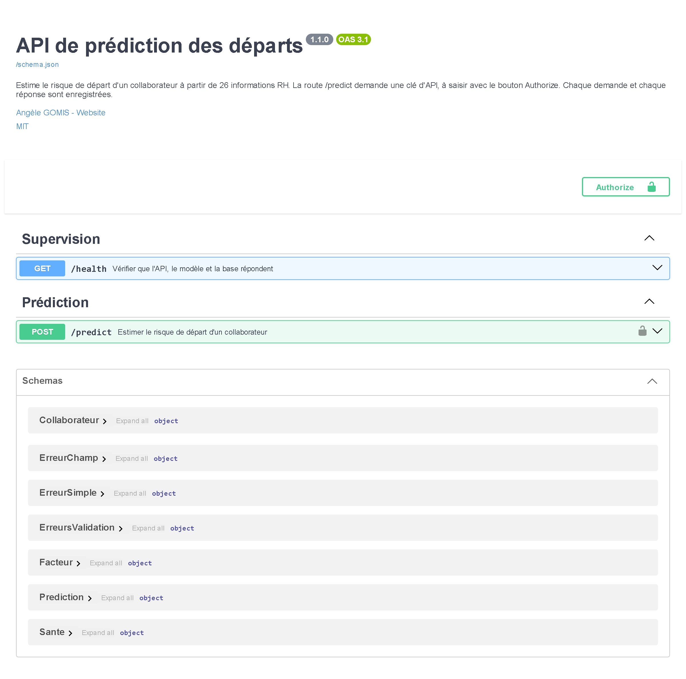
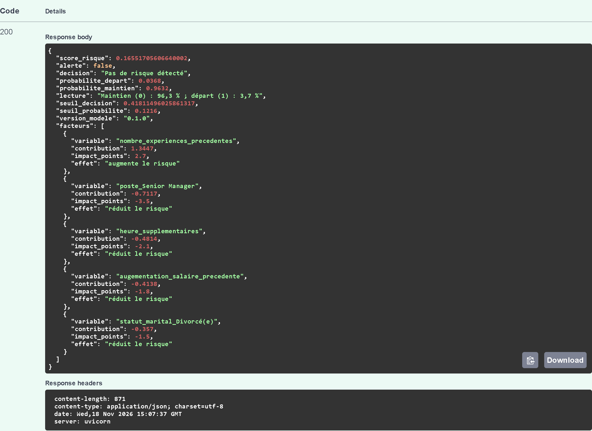

# Guide d'utilisation de l'API

Ce guide s'adresse aux personnes qui interrogent l'API : une équipe RH depuis la
page Swagger, ou une application qui l'appelle. L'installation et l'administration
du service sont décrites dans le [README](../README.md).

## Sommaire

1. [Ce que fait l'API](#ce-que-fait-lapi)
2. [Avant de commencer](#avant-de-commencer)
3. [Vérifier que le service répond](#vérifier-que-le-service-répond)
4. [Envoyer une demande depuis Swagger](#envoyer-une-demande-depuis-swagger)
5. [Les 26 informations à fournir](#les-26-informations-à-fournir)
6. [Lire la réponse](#lire-la-réponse)
7. [Les erreurs](#les-erreurs)
8. [Appeler l'API depuis un programme](#appeler-lapi-depuis-un-programme)
9. [Bon usage et confidentialité](#bon-usage-et-confidentialité)

## Ce que fait l'API

Pour un collaborateur, l'API :

- estime sa probabilité de départ et de maintien, en pourcentages ;
- lève une alerte quand ce risque atteint le seuil retenu ;
- liste les cinq informations qui pèsent le plus dans le résultat, avec leur effet
  en points de pourcentage.

Elle aide à préparer un échange RH. Elle ne décide pas.

## Avant de commencer

| Élément | Où le trouver |
| --- | --- |
| Adresse de l'API | <http://localhost:8000> pour le déploiement local de la preuve de concept |
| Clé d'API | Remise par l'administrateur, une seule fois, à la création du client. Elle ne peut pas être retrouvée : la ranger dans un gestionnaire de mots de passe. En cas de perte ou de fuite, demander à l'administrateur de désactiver la clé et d'en créer une autre. |
| Informations du collaborateur | Les 26 informations de la [section 5](#les-26-informations-à-fournir), issues du SIRH, des évaluations et du sondage interne |

## Vérifier que le service répond

Ouvrir <http://localhost:8000/health> dans un navigateur. Aucune clé n'est
demandée.

| Ce qui s'affiche | Signification |
| --- | --- |
| `{"statut": "ok", ..., "base_de_donnees": "ok"}` | L'API, le modèle et la base répondent : tout est prêt |
| Une erreur 503 | La base de données est injoignable : prévenir l'administrateur |
| La page ne se charge pas | L'API n'est pas démarrée : prévenir l'administrateur |

## Envoyer une demande depuis Swagger

Swagger est la page de documentation interactive de l'API : elle permet d'envoyer
une demande sans rien installer.

| N° | Action | Résultat attendu |
| --- | --- | --- |
| 1 | Ouvrir <http://localhost:8000/docs> | La page liste deux routes : `GET /health` et `POST /predict` |
| 2 | Cliquer sur « Authorize », coller la clé dans le champ `X-API-Key`, cliquer sur « Authorize », puis sur « Close » | Le cadenas se ferme : la clé accompagnera chaque demande |
| 3 | Ouvrir `POST /predict`, puis cliquer sur « Try it out » | Le corps de la demande devient modifiable ; il est prérempli avec un exemple |
| 4 | Remplacer les valeurs de l'exemple par celles du collaborateur | Les noms des champs restent tels quels, fautes de frappe comprises (voir la section 5) |
| 5 | Cliquer sur « Execute » | La réponse s'affiche sous « Server response », avec le code 200 |





Swagger affiche aussi une commande `curl` qui contient la clé : ne pas la copier
dans un document ou un message.

## Les 26 informations à fournir

Les 26 champs sont obligatoires. Un champ inconnu est refusé : aucun nom, aucun
identifiant n'est à ajouter. Les nombres sont des entiers.

Quelques noms de champs gardent les fautes de frappe du fichier RH d'origine :
`annes_sous_responsable_actuel`, `augementation_salaire_precedente`,
`heure_supplementaires`. Ils s'écrivent exactement ainsi.

| Champ | Information | Valeurs acceptées |
| --- | --- | --- |
| `age` | Âge, en années | 18 à 70 |
| `genre` | Genre | `F`, `M` |
| `revenu_mensuel` | Revenu mensuel brut | 1 à 50 000 |
| `statut_marital` | Situation familiale | `Célibataire`, `Divorcé(e)`, `Marié(e)` |
| `departement` | Département | `Commercial`, `Consulting`, `Ressources Humaines` |
| `poste` | Intitulé du poste | `Assistant de Direction`, `Cadre Commercial`, `Consultant`, `Directeur Technique`, `Manager`, `Représentant Commercial`, `Ressources Humaines`, `Senior Manager`, `Tech Lead` |
| `nombre_experiences_precedentes` | Nombre d'employeurs précédents | 0 à 20 |
| `annee_experience_totale` | Années d'expérience professionnelle, en tout | 0 à 50 |
| `annees_dans_l_entreprise` | Ancienneté dans l'entreprise, en années | 0 à 50 |
| `annees_dans_le_poste_actuel` | Ancienneté dans le poste actuel, en années | 0 à 50 |
| `annees_depuis_la_derniere_promotion` | Années depuis la dernière promotion | 0 à 50 |
| `annes_sous_responsable_actuel` | Années sous le responsable actuel | 0 à 50 |
| `satisfaction_employee_environnement` | Satisfaction : environnement de travail | 1 (faible) à 4 |
| `satisfaction_employee_nature_travail` | Satisfaction : nature du travail | 1 (faible) à 4 |
| `satisfaction_employee_equipe` | Satisfaction : équipe | 1 (faible) à 4 |
| `satisfaction_employee_equilibre_pro_perso` | Satisfaction : équilibre entre vie professionnelle et vie personnelle | 1 (faible) à 4 |
| `note_evaluation_precedente` | Note de l'évaluation précédente | 1 à 4 |
| `note_evaluation_actuelle` | Note de l'évaluation actuelle | 1 à 4 |
| `heure_supplementaires` | Fait des heures supplémentaires | `Non`, `Oui` |
| `augementation_salaire_precedente` | Dernière augmentation, en pourcentage | 0 à 100 |
| `nombre_participation_pee` | Participations au plan d'épargne entreprise | 0 à 10 |
| `nb_formations_suivies` | Formations suivies | 0 à 20 |
| `distance_domicile_travail` | Distance entre le domicile et le travail, en kilomètres | 0 à 200 |
| `niveau_education` | Niveau d'études, codé comme dans le SIRH | 1 à 5 |
| `domaine_etude` | Domaine d'études | `Autre`, `Entrepreunariat`, `Infra & Cloud`, `Marketing`, `Ressources Humaines`, `Transformation Digitale` |
| `frequence_deplacement` | Déplacements professionnels | `Aucun`, `Occasionnel`, `Frequent` |

Le profil doit aussi être cohérent, sinon il est refusé :

- l'ancienneté dans le poste, les années depuis la dernière promotion et les années
  sous le responsable actuel ne dépassent pas l'ancienneté dans l'entreprise ;
- l'ancienneté dans l'entreprise ne dépasse pas l'expérience totale ;
- l'âge moins l'expérience totale vaut au moins 16 ans.

Deux profils complets servent d'exemples : `docs/exemples/collaborateur_avec_alerte.json`
et `docs/exemples/collaborateur_sans_alerte.json`.

## Lire la réponse

Réponse pour le profil `collaborateur_avec_alerte.json`, une commerciale de 24 ans
en début de carrière :

```json
{
  "score_risque": 0.5635079303305954,
  "alerte": true,
  "decision": "Risque de départ",
  "probabilite_depart": 0.1992,
  "probabilite_maintien": 0.8008,
  "lecture": "Maintien (0) : 80,1 % ; départ (1) : 19,9 %",
  "seuil_decision": 0.41811496025861317,
  "seuil_probabilite": 0.1216,
  "version_modele": "0.1.0",
  "facteurs": [
    {
      "variable": "poste_Représentant Commercial",
      "contribution": 1.2877,
      "impact_points": 13.5,
      "effet": "augmente le risque"
    },
    {
      "variable": "debut_de_carriere",
      "contribution": 1.0941,
      "impact_points": 12.2,
      "effet": "augmente le risque"
    },
    {
      "variable": "frequence_deplacement",
      "contribution": -0.9814,
      "impact_points": -20.0,
      "effet": "réduit le risque"
    },
    {
      "variable": "nouveau_responsable",
      "contribution": 0.7488,
      "impact_points": 9.4,
      "effet": "augmente le risque"
    },
    {
      "variable": "annee_experience_totale",
      "contribution": 0.6288,
      "impact_points": 8.2,
      "effet": "augmente le risque"
    }
  ]
}
```

### Le résultat

| Champ | Ce qu'il dit | Dans l'exemple |
| --- | --- | --- |
| `decision` | L'alerte, en clair | « Risque de départ » |
| `lecture` | Les deux probabilités en pourcentages : maintien (classe 0) et départ (classe 1) | 80,1 % de maintien, 19,9 % de départ |
| `probabilite_depart`, `probabilite_maintien` | Les mêmes probabilités, entre 0 et 1, pour un programme | 0,1992 et 0,8008 |
| `alerte` | Vrai quand la probabilité de départ atteint le seuil | `true` |
| `seuil_probabilite` | Le seuil d'alerte, en probabilité de départ : environ 12 % | 19,9 % dépasse 12 % : d'où l'alerte |
| `score_risque`, `seuil_decision` | Le score interne du modèle et son seuil. Ils donnent la même alerte, mais ne se lisent pas comme des pourcentages | 0,56 et 0,418 |
| `version_modele` | La version du modèle qui a calculé | `0.1.0` |
| `facteurs` | La fiche RH : les cinq informations qui pèsent le plus | Voir ci-dessous |

Pourquoi une alerte à 19,9 % ? En moyenne, 16 % des collaborateurs partent. Le
seuil de 12 % est volontairement bas, pour manquer peu de départs : l'alerte
signale un risque supérieur à la normale, pas un départ certain.

### La fiche RH

Chaque facteur indique son effet sur la probabilité de départ, en points de
pourcentage (`impact_points`), par rapport à un collaborateur moyen de l'entreprise.

| Facteur | Effet | Lecture |
| --- | --- | --- |
| `poste_Représentant Commercial` | +13,5 points | Occuper ce poste augmente le risque |
| `debut_de_carriere` | +12,2 points | Deux ans d'expérience au plus augmentent le risque |
| `frequence_deplacement` | −20,0 points | Ne jamais se déplacer réduit le risque |
| `nouveau_responsable` | +9,4 points | Aucune année encore sous le responsable actuel augmente le risque |
| `annee_experience_totale` | +8,2 points | Une expérience totale courte augmente le risque |

Pour lire les noms des facteurs :

- un nom de la forme `champ_Valeur` désigne une valeur précise : `poste_Représentant
  Commercial` veut dire « le poste est Représentant Commercial » ;
- trois facteurs sont calculés par le modèle à partir des 26 informations :
  `satisfaction_minimale` (la plus basse des quatre satisfactions),
  `nouveau_responsable` (aucune année sous le responsable actuel) et
  `debut_de_carriere` (deux ans d'expérience au plus).

À savoir :

- chaque effet se lit seul, toutes les autres informations restant égales : les
  effets ne s'additionnent pas ;
- `contribution` donne le même poids dans l'échelle interne du modèle (la
  log-cote) : il sert surtout aux analystes ;
- `effet` résume le sens : « augmente le risque » ou « réduit le risque ».

## Les erreurs

| Code | Signification | Que faire |
| --- | --- | --- |
| 401 | Clé absente, inconnue ou désactivée | Vérifier la clé saisie dans « Authorize » ; sinon, demander une nouvelle clé |
| 422 | Une ou plusieurs informations sont refusées | Corriger chaque champ listé, puis renvoyer la demande |
| 500 | La base a refusé d'enregistrer la demande | Prévenir l'administrateur |
| 503 | La base de données est injoignable | Réessayer plus tard ; prévenir l'administrateur si cela dure |

Une erreur 422 liste chaque champ refusé, avec la raison :

```json
{
  "detail": [
    {
      "champ": "age",
      "message": "La valeur doit être supérieure ou égale à 18."
    },
    {
      "champ": "genre",
      "message": "Valeur non autorisée. Valeurs possibles : 'F' ou 'M'."
    }
  ]
}
```

En cas d'erreur, aucune prédiction n'est renvoyée. Une demande refusée (401 ou
422) n'est pas enregistrée.

## Appeler l'API depuis un programme

La clé se garde dans une variable d'environnement, `CLE_API`, jamais dans le code
ni dans un fichier partagé. Les exemples envoient le profil
`docs/exemples/collaborateur_avec_alerte.json`.

### PowerShell (Windows)

Définir la clé une fois par session, en remplaçant `ma-cle` par la clé reçue :

```powershell
$env:CLE_API = "ma-cle"
```

Envoyer le profil et afficher le résultat :

```powershell
$reponse = Invoke-RestMethod -Method Post -Uri http://localhost:8000/predict -Headers @{ "X-API-Key" = $env:CLE_API } -ContentType "application/json" -InFile docs/exemples/collaborateur_avec_alerte.json
$reponse.lecture
$reponse.facteurs | Format-Table variable, impact_points, effet
```

### curl (macOS, Linux, Git Bash)

```bash
curl -X POST http://localhost:8000/predict -H "X-API-Key: $CLE_API" -H "Content-Type: application/json" -d @docs/exemples/collaborateur_avec_alerte.json
```

### Python

Avec la bibliothèque `requests` (`pip install requests`) :

```python
import json
import os

import requests

with open("docs/exemples/collaborateur_avec_alerte.json", encoding="utf-8") as fichier:
    collaborateur = json.load(fichier)

reponse = requests.post(
    "http://localhost:8000/predict",
    json=collaborateur,
    headers={"X-API-Key": os.environ["CLE_API"]},
    timeout=10,
)
reponse.raise_for_status()
resultat = reponse.json()

print(resultat["decision"], "|", resultat["lecture"])
for facteur in resultat["facteurs"]:
    print(f"{facteur['variable']} : {facteur['impact_points']:+.1f} points")
```

Résultat affiché :

```text
Risque de départ | Maintien (0) : 80,1 % ; départ (1) : 19,9 %
poste_Représentant Commercial : +13.5 points
debut_de_carriere : +12.2 points
frequence_deplacement : -20.0 points
nouveau_responsable : +9.4 points
annee_experience_totale : +8.2 points
```

## Bon usage et confidentialité

- **Une aide, pas une décision.** Le modèle repère 77 % des départs, au prix de
  fausses alertes : près de deux alertes sur trois ne sont pas suivies d'un départ.
  Une alerte invite à un échange avec le collaborateur, rien de plus.
- **Des données personnelles.** Aucun nom n'est demandé. Chaque demande et chaque
  réponse sont enregistrées, rattachées à la clé qui les a envoyées.
- **Des informations sensibles.** Le genre, la situation familiale et l'âge font
  partie des 26 informations. Leur poids apparaît dans la fiche RH quand il compte :
  il se lit avec discernement, jamais comme un motif de décision.
- **Des limites.** Le modèle a été construit sur les données d'une seule
  entreprise. Près des valeurs maximales acceptées, loin des profils connus, le
  résultat est moins fiable.
- **Une clé personnelle.** Elle ne se partage pas, ni par message ni dans un
  document. En cas de doute, demander à l'administrateur de la désactiver.
