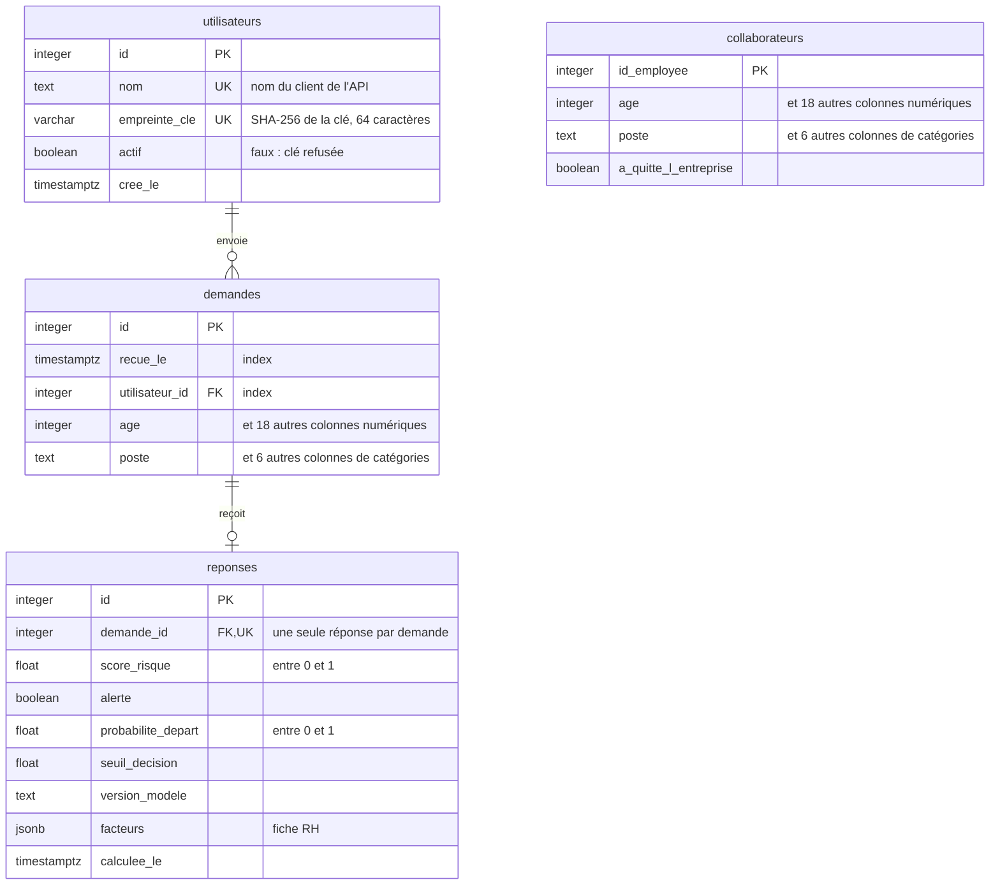

# Schéma de la base de données

La base PostgreSQL `p5` contient le jeu de données du projet 4 et la trace de
chaque échange avec le modèle. Les tables sont décrites dans `src/bdd/modeles.py`
et créées par `scripts/creer_base.py`.

## Modèle de données

## Tables

| Table | Rôle | Volume |
| --- | --- | --- |
| `collaborateurs` | Jeu de données complet du projet 4 : les 26 variables d'entrée et le départ observé ; lu par `POST /predict/{id_employee}` | 1 470 lignes, fixe |
| `utilisateurs` | Clients autorisés à appeler l'API | Quelques lignes |
| `demandes` | Données reçues par `POST /predict`, ou lues pour `POST /predict/{id_employee}`, enregistrées avant tout calcul | Une ligne par appel accepté |
| `reponses` | Prédiction renvoyée, reliée à sa demande | Une ligne par demande servie |

`reponses` garde le score, l'alerte et la probabilité de départ communiquée aux
RH. La décision en clair, la probabilité de maintien et le seuil exprimé en
probabilité se déduisent de ces colonnes : je ne les stocke pas, pour qu'une
même information n'existe qu'à un seul endroit.

`collaborateurs` et `demandes` partagent les mêmes 26 colonnes, construites à
partir de `src/config.py` : le schéma de l'API, le modèle et la base s'appuient
sur une seule définition.

## Contraintes

| Contrainte | Où | Ce qu'elle garantit |
| --- | --- | --- |
| Clé primaire | Chaque table | Une ligne se retrouve sans ambiguïté |
| Clé étrangère | `demandes.utilisateur_id`, `reponses.demande_id` | Pas de demande sans client, pas de réponse sans demande |
| Unicité | `utilisateurs.nom`, `utilisateurs.empreinte_cle`, `reponses.demande_id` | Une clé désigne un seul client ; une demande n'a qu'une réponse |
| `NOT NULL` | Toutes les colonnes | Aucune information manquante |
| `CHECK` sur les modalités | Les 7 colonnes de catégories | Seules les modalités connues du modèle sont acceptées |
| `CHECK` de cohérence métier | `collaborateurs` et `demandes` | Les règles de l'API, vérifiées aussi par la base : poste, dernière promotion et responsable actuel dans l'ancienneté, ancienneté dans l'expérience totale, revenu positif, entrée dans la vie active à 16 ans au plus tôt |
| `CHECK` sur le score et la probabilité | `reponses.score_risque`, `reponses.probabilite_depart` | Les deux restent entre 0 et 1 |
| Types | Entiers, texte, booléens, dates avec fuseau, JSON | Une valeur du mauvais type est refusée |

## Gestion du volume

- Index sur `demandes.recue_le` : les recherches par période restent rapides quand
  la table grandit.
- Index sur `demandes.utilisateur_id` : le suivi par client ne parcourt pas toute
  la table.
- Les traces ne sont jamais modifiées : la table ne fait que grandir, ce qui se
  prête à une purge ou à un archivage par période (voir le README).

## Rôles et droits

| Rôle | Utilisé par | Droits |
| --- | --- | --- |
| Propriétaire (`POSTGRES_USER`) | Scripts de création, d'insertion et de gestion des clients | Tous les droits sur la base |
| API (`POSTGRES_API_USER`) | L'application | Lecture des quatre tables, ajout dans `demandes` et `reponses` ; ni modification, ni suppression |

Si l'API est compromise, elle ne peut ni effacer ni réécrire l'historique des
prédictions, ni créer un client.
