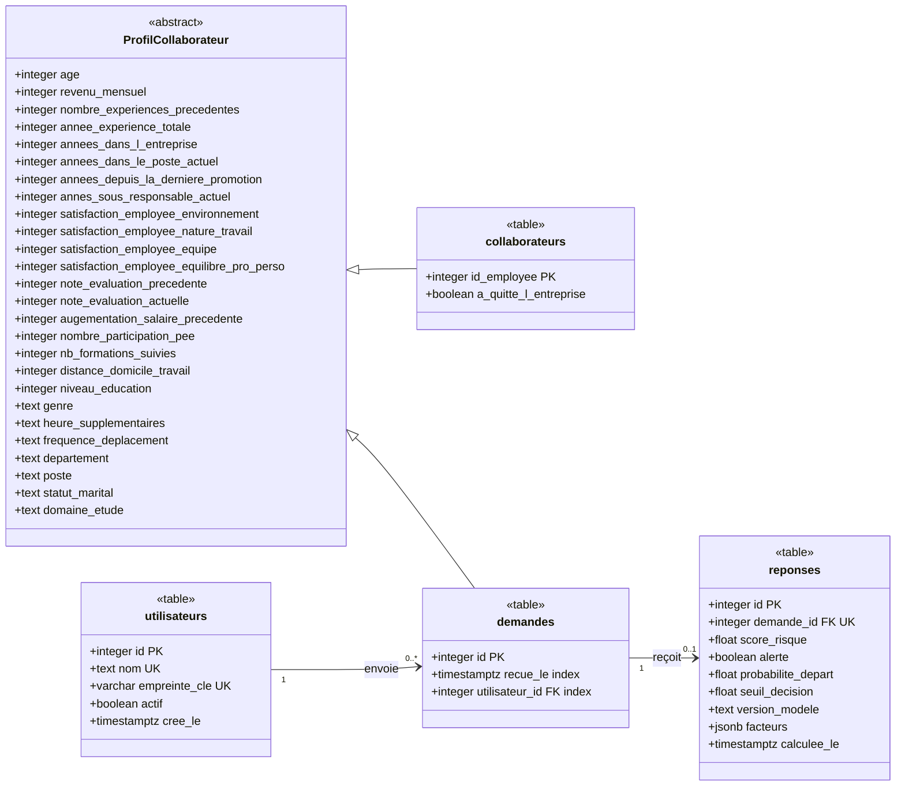

# Schéma UML de la base de données

Diagramme de classes UML de la base PostgreSQL `p5`. Il décrit les mêmes tables
que le diagramme entité-association de `docs/schema_bdd.md`, avec les
conventions UML : stéréotypes, types, multiplicités et généralisation.

Les tables sont définies dans `src/bdd/modeles.py` et créées par
`scripts/creer_base.py`.

## Diagramme de classes

## Lecture du diagramme

| Élément UML | Signification dans la base |
| --- | --- |
| `<<table>>` | Classe matérialisée par une table PostgreSQL |
| `<<abstract>>` | Classe non matérialisée : elle regroupe les 26 colonnes communes |
| Généralisation (flèche à triangle) | La table reprend toutes les colonnes de `ProfilCollaborateur` |
| Association `1` vers `0..*` | Un client envoie zéro, une ou plusieurs demandes ; chaque demande a un seul client |
| Association `1` vers `0..1` | Une demande reçoit au plus une réponse ; chaque réponse vient d'une seule demande |
| `PK`, `FK`, `UK` | Clé primaire, clé étrangère, contrainte d'unicité |

`ProfilCollaborateur` n'existe pas en base. Il représente la fonction
`colonnes_collaborateur()` de `src/bdd/modeles.py`, qui construit les 26
colonnes à partir de `src/config.py` pour `collaborateurs` et pour `demandes`.
Le diagramme montre ainsi que le jeu de données du projet 4 et les entrées
reçues par l'API partagent une seule définition, celle qu'utilise aussi le
schéma Pydantic.

La multiplicité `0..1` côté `reponses` traduit la contrainte d'unicité sur
`reponses.demande_id`. Elle vaut zéro lorsque la demande est enregistrée mais
que le calcul échoue : la demande reste tracée, sans réponse.

## Contraintes portées par les classes

| Classe | Contraintes |
| --- | --- |
| `ProfilCollaborateur` | `NOT NULL` partout ; `CHECK` sur les modalités des 7 colonnes texte ; `CHECK` de cohérence des durées, revenu positif, entrée dans la vie active à 16 ans au plus tôt |
| `reponses` | `CHECK` : `score_risque` et `probabilite_depart` entre 0 et 1 |
